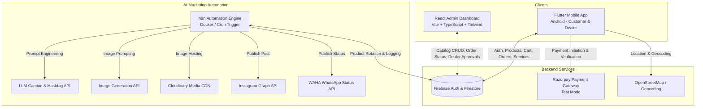

# AquaPure: Commercial Water Purifier E-Commerce, Admin Portal & AI Marketing Automation System

AquaPure is a full-stack, enterprise-grade water purification e-commerce and maintenance ecosystem. It combines an **Android Mobile Application (Flutter)** for retail customers and wholesale commercial dealers, a **React + Vite + TypeScript Admin Dashboard** deployed to Vercel, and an **Autonomous AI Social Media Marketing Pipeline (n8n)** that generates and publishes daily product campaigns to Instagram and WhatsApp Status.

---

## 1. System Architecture



---

## 2. Technology Stack

### Mobile Application (`mobile/water_purifier_app`)
- **Framework**: Flutter (Dart), Material 3 design system.
- **State Management**: `Provider` architecture with separation of presentation and business logic.
- **Routing**: `GoRouter` with nested `ShellRoute` tabs and parameter passing.
- **Authentication & Database**: Firebase Authentication and Cloud Firestore SDKs.
- **Payment Gateway**: Razorpay Test Mode integration with safe offline fallback.
- **Location Services**: OpenStreetMap Nominatim geocoding and reverse lookup.
- **UI & UX**: Google Fonts (Outfit & Inter), CachedNetworkImage, responsive cards, zoom lightbox, and dark/light themes.

### Admin Web Dashboard (`admin/admin-panel`)
- **Framework**: React 18, Vite, TypeScript.
- **Styling**: Tailwind CSS, Lucide React icons.
- **Routing**: React Router DOM (v6) with Vercel SPA rewrites (`vercel.json`).
- **Database Operations**: Firebase JavaScript SDK with fallback to stateful in-memory service.
- **Deployment**: Production-ready for Vercel.

### AI Marketing Automation (`automation/`)
- **Automation Engine**: n8n (Docker containerized) with Daily Schedule Trigger (`09:00 AM IST`, `Asia/Kolkata`).
- **Deterministic Selector**: Rotates across all catalogue products by least-posted item.
- **Copywriting**: LLM API (Google Gemini / OpenAI) generating catchy headline hooks, verified benefits, call-to-action, and 3-6 hashtags.
- **Image Generation**: FLUX / SDXL / DALL-E inference with fallback to high-resolution product photography.
- **Media Hosting**: Cloudinary CDN for public HTTPS media containers.
- **Social Publishing**: Meta Instagram Graph API (`/media` and `/media_publish`).
- **Bonus Channel**: WAHA (WhatsApp HTTP API) for automated WhatsApp Status broadcasts.

---

## 3. 60-Product Catalogue Distribution

The system features 60 realistic water treatment and purification products (`product-data/products.json`):

| Category | Count | Highlights |
| :--- | :--- | :--- |
| **Water Purifiers** | 15 Models | Copper Pro RO+UV, Smart IoT Mineral RO, Direct-Flow Tankless, Bio-Alkaline Zinc Boost, Medical Grade |
| **Water Dispensers** | 10 Models | Floor-Standing Compressor Cooled, Bottom-Loading Ergonomic, Tabletop Compact, Touchless Infrared |
| **Booster Pumps** | 10 Models | 75 GPD Copper-Wound 24V, 100 GPD Turbo 24V, 150 GPD 36V, 300 GPD 48V, Self-Priming Suction |
| **Filters & Cartridges** | 15 Models | 5-Micron Spun PP, GAC Coconut Carbon, 80 GPD TFC RO Membrane, Bio-Alkaline Antioxidant, UV Lamp |
| **Spare Parts & Fittings** | 10 Models | 24V 2.5A SMPS Adapter, 24V Solenoid Valve, High/Low Pressure Switches, TDS Controller Needle Valve |

---

## 4. User Roles & Access Control (RBAC)

The system enforces three distinct roles in both UI and Firestore Security Rules:

1. **Customer (Retail)**:
   - Registers and browses 60 products at standard retail MRP.
   - Adds items to cart with automatic free delivery calculation (Threshold: ₹1500).
   - Places retail orders via Razorpay Test Mode or COD.
   - Tracks 5-stage order status (`placed` -> `confirmed` -> `processing` -> `shipped` -> `delivered`).
   - Books service appointments (Installation, Repair, Filter Change, Maintenance).
   - Generates unique referral codes and tracks referral rewards.
2. **Dealer (Commercial Wholesale)**:
   - Submits commercial application with Company Name, GSTIN, and business address.
   - Enters system with `dealerStatus = pending`.
   - **Security Invariant**: Wholesale prices remain strictly hidden and wholesale ordering is blocked until an administrator approves the application.
   - Once approved (`dealerStatus = approved`), wholesale trade discounts (28% - 35% off retail) unlock automatically across the catalogue.
   - Can place bulk volume orders and view dedicated dealer order history.
3. **Administrator (Operations Control)**:
   - Accesses protected React Admin Dashboard on Vercel.
   - Dashboard KPI analytics: total orders, revenue, active products, low stock, pending applications.
   - Full Product CRUD, active/inactive toggles, and stock adjustments.
   - Order processing workflow with permitted status transitions.
   - One-click approve/reject for dealer applications with confirmation dialogs.
   - Service Desk ticket management and technician dispatch.
   - AI Marketing execution logs and manual pipeline trigger.

---

## 5. Instant Evaluator Demo Credentials

Both the Flutter mobile app and the React admin panel feature one-click Evaluator Demo modes:

### Admin Web Dashboard
- **URL**: `http://localhost:5173/` (or your live Vercel URL)
- **Email**: `admin@aquapure.com`
- **Password**: `admin123`

### Mobile Application Evaluator Modes
Use the **Role Switcher** chip on the Login screen or Profile screen:
- **Retail Customer**: `rahul.sharma@example.com` / `password123`
- **Approved Dealer**: `dealer.approved@aquapure.com` / `password123`
- **Pending Dealer**: `dealer.pending@aquapure.com` / `password123`

---

## 6. Quick Start & Execution Commands

### A. Run React Admin Dashboard Locally
```bash
cd admin/admin-panel
npm install
npm run dev
```
Open `http://localhost:5173/` in your browser.

### B. Run Flutter Mobile Application
```bash
cd mobile/water_purifier_app
flutter pub get
flutter test
flutter run
```

### C. Seed Database / Create Admin (Optional)
```bash
cd product-data
npm install firebase-admin
node seed.js --dry-run
# To write live: place serviceAccountKey.json and run: node seed.js --create-admin admin@aquapure.com "AquaPure Admin"
```

### D. Run Marketing Automation Test Suite
```bash
node automation/test-workflow.js
```

---

## 7. Project Documentation Index

- [Architecture & Schema](file:///c:/Users/smart/Downloads/water-purifier-project/docs/ARCHITECTURE.md): Complete Firestore data contracts and system diagrams.
- [Setup Guide](file:///c:/Users/smart/Downloads/water-purifier-project/docs/SETUP.md): Step-by-step installation instructions.
- [Testing Guide](file:///c:/Users/smart/Downloads/water-purifier-project/docs/TESTING.md): Automated tests, security rule invariants, and manual QA checklist.
- [Deployment Guide](file:///c:/Users/smart/Downloads/water-purifier-project/docs/DEPLOYMENT.md): Vercel configuration, Android release APK build, and cloud n8n hosting.
- [Automation Guide](file:///c:/Users/smart/Downloads/water-purifier-project/automation/README.md): Meta Instagram Graph API, Cloudinary, and WAHA WhatsApp Status setup.
