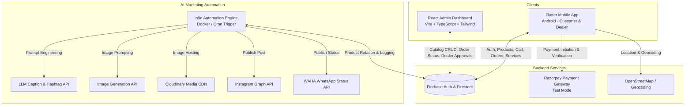

# AquaPure: Water Purifier E-Commerce & AI Marketing Automation System
## Architecture & Technical Specification

### 1. System Overview
AquaPure is an end-to-end commercial-grade water purification e-commerce and maintenance ecosystem consisting of three primary tiers:

---

### 2. Core Entities & Firestore Schema

#### `users`
- `uid`: string (Primary key matching Firebase Auth UID)
- `email`: string
- `fullName`: string
- `phone`: string
- `role`: enum (`customer` | `dealer` | `admin`)
- `dealerStatus`: enum (`none` | `pending` | `approved` | `rejected`)
- `companyName`: string (dealer only)
- `gstNumber`: string (dealer only)
- `referralCode`: string
- `referredBy`: string (optional)
- `addresses`: array of Address objects
- `createdAt`: timestamp
- `updatedAt`: timestamp

#### `products`
- `id`: string (e.g. `AP-RO-001`)
- `name`: string
- `category`: enum (`purifier` | `dispenser` | `pump` | `filter` | `spare_part`)
- `shortDescription`: string
- `detailedDescription`: string
- `retailPrice`: number (INR)
- `wholesalePrice`: number (INR - visible only to approved dealers)
- `stockQuantity`: number
- `imageUrl`: string (High-res CDN URL)
- `thumbnailUrl`: string
- `isActive`: boolean
- `isFeatured`: boolean
- `rating`: number
- `specifications`: map (e.g., Purification Capacity, Stages, Membrane, Voltage)
- `verifiedBenefit`: string (used for marketing automation)
- `postedCount`: number
- `lastPostedAt`: timestamp (optional)
- `createdAt`: timestamp
- `updatedAt`: timestamp

#### `orders`
- `id`: string (e.g. `ORD-20261023-XXXX`)
- `userId`: string
- `userEmail`: string
- `userName`: string
- `userPhone`: string
- `role`: enum (`customer` | `dealer`)
- `items`: array of CartItemSnapshots (productId, name, priceAtOrder, quantity, subtotal)
- `subtotal`: number
- `discountAmount`: number
- `shippingCharge`: number
- `totalAmount`: number
- `shippingAddress`: Address object
- `paymentMethod`: enum (`razorpay_test` | `cash_on_delivery` | `demo_mock`)
- `paymentStatus`: enum (`pending` | `paid` | `failed` | `refunded`)
- `razorpayOrderId`: string (optional)
- `razorpayPaymentId`: string (optional)
- `orderStatus`: enum (`placed` | `confirmed` | `processing` | `shipped` | `delivered` | `cancelled`)
- `statusHistory`: array of { status, timestamp, note }
- `createdAt`: timestamp
- `updatedAt`: timestamp

#### `serviceBookings`
- `id`: string (e.g. `SRV-20261023-XXXX`)
- `userId`: string
- `customerName`: string
- `customerPhone`: string
- `serviceType`: enum (`installation` | `repair` | `filter_replacement` | `maintenance`)
- `preferredDate`: string (YYYY-MM-DD)
- `preferredTimeSlot`: string
- `address`: Address object
- `issueDescription`: string
- `status`: enum (`submitted` | `scheduled` | `technician_assigned` | `in_progress` | `completed` | `cancelled`)
- `technicianName`: string (optional)
- `technicianPhone`: string (optional)
- `serviceNotes`: string
- `createdAt`: timestamp
- `updatedAt`: timestamp

#### `notifications`
- `id`: string
- `userId`: string
- `title`: string
- `body`: string
- `type`: string (`order` | `dealer` | `service` | `promo`)
- `referenceId`: string
- `isRead`: boolean
- `createdAt`: timestamp

#### `automationLogs`
- `id`: string
- `productId`: string
- `productName`: string
- `timestamp`: timestamp
- `channel`: enum (`instagram` | `whatsapp_status`)
- `caption`: string
- `imageUrl`: string
- `postIdentifier`: string
- `status`: enum (`success` | `failed`)
- `errorMessage`: string (optional)
